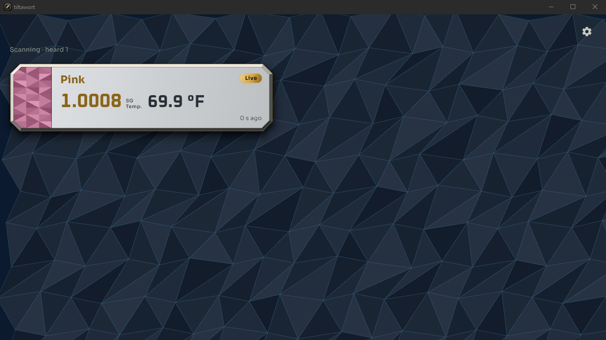
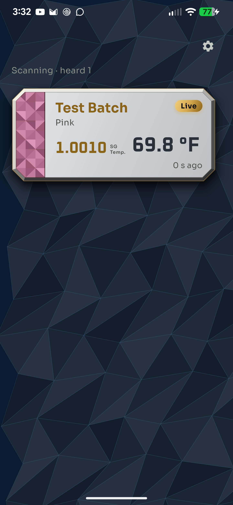

# Tilt-a-Wort

Tilt-a-Wort listens to a Tilt hydrometer floating in your beer. It shows gravity and temperature, and can keep a chart and a CSV on your own device. It does not connect to the Tilt, change its settings, or upload anywhere.





## Install

Downloads: [github.com/NotGovernor/TiltaWort/releases](https://github.com/NotGovernor/TiltaWort/releases)

### Windows

Download `Tilt-a-Wort-windows-x64.zip` from that release, unzip it, and run `tiltawort.exe`. This app is not in the Microsoft Store and is not signed. Windows SmartScreen will warn you. Click **More info**, then **Run anyway**. Turn Bluetooth on. The PC does not need to be discoverable. No pairing. No administrator account.

### Android

Download `tiltawort-android.apk` from that release. This app is not on the Play Store. Open the APK and allow install from that source. Android may ask for Bluetooth and nearby-devices permission (and location on older versions) so the phone can hear the broadcast. The app only listens. It does not connect. The APK is signed with the debug key on purpose, so we are not buying a Play upload key. Updates only work if the next APK uses that same key.

### iPhone, Mac, and Linux

No download. An iPhone build needs a Mac. Building from source is under [For developers](#for-developers).

## Using it

Turn Bluetooth on. Each Tilt color is one tile. Tap a tile for the chart and log. The beer name is ours — it is not written to the float. Status is Live, Stale, or Empty. Those words are honest.

## License

See [LICENSE](LICENSE). Oxanium and Sora are SIL Open Font License (`fonts/OFL-Oxanium.txt`, `fonts/OFL-Sora.txt`).

## For developers

A Tilt (original, Pro, Pro Mini) is a one-way BLE iBeacon. It broadcasts specific gravity and temperature about every 5 seconds. It has no Wi-Fi, no cellular, no pairing, and no settings you can change over Bluetooth. Names, units, calibration, and logs belong on this device, keyed by color UUID. Never claim the float accepted a write.

### Sleep / wake (hardware, not BLE)

- Stand vertical or lay on its side → sleep (blue LED).
- Float in roughly 0.990–1.200 SG → wake (green/red LED related to battery).
- After a battery change: purple LED means device-level tare — float in still room-temp water so firmware aims broadcast SG at 1.000. That is physical, not an app command.

### Color is the UUID (factory)

Same eight UUIDs for Tilt, Tilt Pro, and Tilt Pro Mini.

| Color  | UUID                                   |
|--------|----------------------------------------|
| Red    | `A495BB10-C5B1-4B44-B512-1370F02D74DE` |
| Green  | `A495BB20-C5B1-4B44-B512-1370F02D74DE` |
| Black  | `A495BB30-C5B1-4B44-B512-1370F02D74DE` |
| Purple | `A495BB40-C5B1-4B44-B512-1370F02D74DE` |
| Orange | `A495BB50-C5B1-4B44-B512-1370F02D74DE` |
| Blue   | `A495BB60-C5B1-4B44-B512-1370F02D74DE` |
| Yellow | `A495BB70-C5B1-4B44-B512-1370F02D74DE` |
| Pink   | `A495BB80-C5B1-4B44-B512-1370F02D74DE` |

Do not copy `baronbrew/tilt-scan` JS — it maps Yellow’s UUID to Pink and omits Yellow.

### Advertisement layout

Apple iBeacon inside BLE Manufacturer Specific Data. Company id `0x004C`.

WinRT / typical host APIs give a map keyed by `0x004C`. The value usually omits `4C 00` and starts at `02 15`:

```
02 15
[16-byte UUID]
major u16 big-endian
minor u16 big-endian
tx     i8  (iBeacon measured power — do not show as battery %)
```

RSSI is not in that blob; it comes from the scan event.

1. Ignore ads with no manufacturer key `0x004C`.
2. Strip optional `4C 00` prefix. Require `02 15` then ≥21 more bytes.
3. UUID = next 16 bytes. Unknown UUID → not a Tilt, drop.
4. `major` / `minor` = big-endian u16.
5. **Standard Tilt:** `temp_f = major` (1 °F steps), `sg = minor / 1000` (0.001 SG).
6. **Tilt Pro / Pro Mini:** if `minor > 5000` then `temp_f = major / 10`, `sg = minor / 10000`. Same UUID table.
7. `°C = (°F − 32) × 5/9`.
8. Do not filter the scanner by these UUIDs as GATT **service** UUIDs — they are iBeacon proximity UUIDs. An empty scan filter is correct.
9. Do not enable Bluetooth Coded PHY on Windows (drops 1M ads on Intel radios).

Test vector (Red, standard Tilt), company `0x004C`, payload:

```
02 15 A4 95 BB 10 C5 B1 4B 44 B5 12 13 70 F0 2D 74 DE 00 44 03 F8 C5
```

Expect: Red, 68.0 °F / 20.0 °C, SG 1.016, not Pro.

Do not: GATT, pairing, firmware, device tare from software, or claiming battery % from the TX-power byte.

### Build

Flutter SDK plus Rust for `native/tilt_listen`. Run `flutter test`.

Windows on this project is CMake plus `flutter assemble`, because `flutter build windows` wants the Visual Studio CMake component and this repo does not require a paid signing cert.

Android sideload: `flutter build apk --release` (already uses the debug signing config). Do not add a keystore.

### Sources

- https://kvurd.com/blog/tilt-hydrometer-ibeacon-data-format
- https://tilthydrometer.com/pages/faqs
- https://tilthydrometer.com/pages/guide
- https://tilthydrometer.com/products/tilt-pro-wireless-hydrometer-and-thermometer
- https://github.com/baronbrew/Tilt-Hydrometer-Framework7
- https://github.com/baronbrew/TiltScan-Bleak
- https://github.com/baronbrew/TiltPico
- https://learn.microsoft.com/en-us/windows/apps/develop/devices-sensors/ble-beacon
